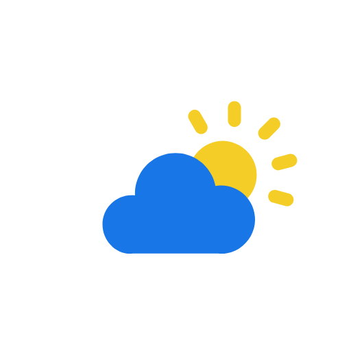
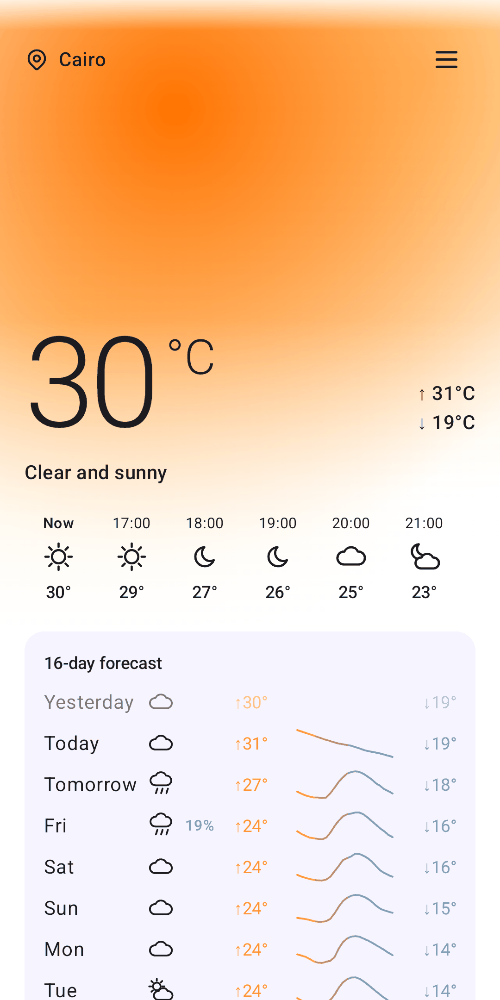
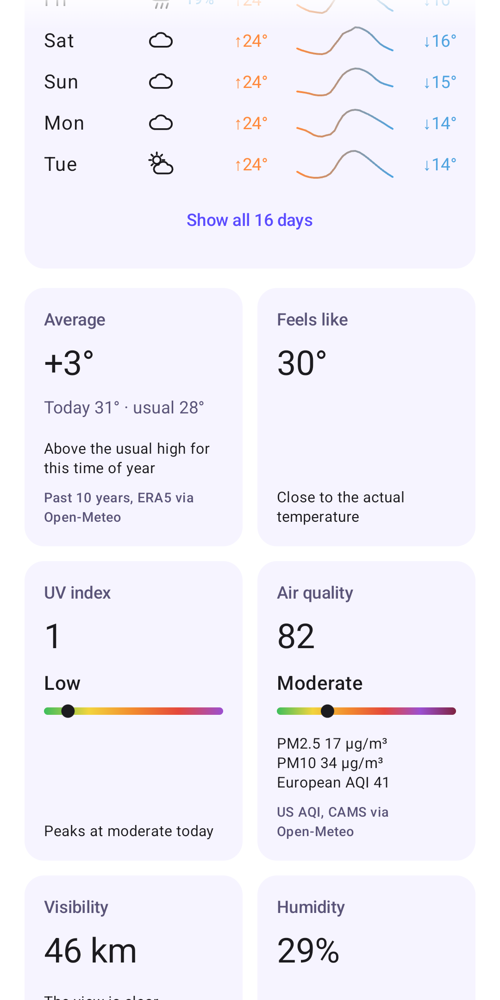
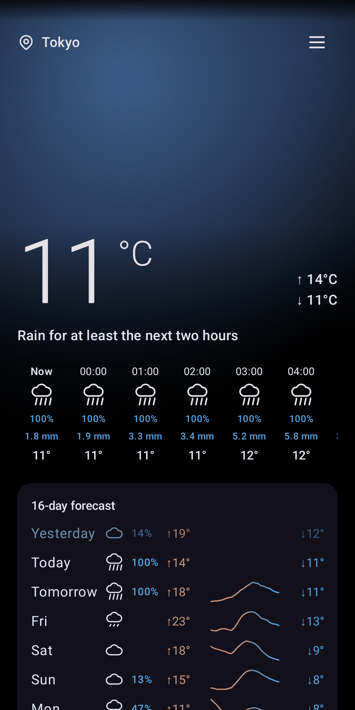

<!--
SPDX-FileCopyrightText: 2026 Saalim Quadri <danascape@gmail.com>
SPDX-License-Identifier: Apache-2.0
-->

# Weather



Forecasts from Open-Meteo and MET Norway, combined. No ads, no tracking.

<p align="center">
  
  
  
</p>

## Features

- One forecast from two free, open sources: where both have a value it shows their average, and
  you can always see what each one said
- Temperature, feels like, rain, wind, humidity, UV and visibility, hour by hour and for 16 days
- Compare sources: both forecasts side by side for the next 48 hours
- Rain starting or stopping in the next two hours
- How sure the forecast is: MET Norway's likely range and a 40-run ensemble
- Weather warnings from MET Norway in Norway
- Today against the usual high for the date over the past 10 years
- Air quality from two sources, pollen in Europe, the moon, the sea and river flow
- Search for any city, or use your location without Google services
- Celsius or Fahrenheit, and km/h, m/s, mph or knots
- Home screen widgets
- Built on [Pvot](https://github.com/PVOT-OSS/PvotLib), the design system behind PVOT-OSS's apps

## Download

<a href="https://play.google.com/store/apps/details?id=org.prauga.weather"></a>
<a href="https://f-droid.org/packages/org.prauga.weather/"></a>
<a href="https://apps.obtainium.imranr.dev/redirect?r=obtainium://add/https://github.com/PVOT-OSS/PvotWeather"></a>
<a href="https://github.com/PVOT-OSS/PvotWeather/releases"></a>

Requires Android 8.1 or newer.

## Privacy

No accounts, no ads, no analytics. To get forecasts the app sends the coordinates of the places you
look at to Open-Meteo and MET Norway, and nothing else about you. See the
[Privacy Policy](PrivacyPolicy.md) and the [Terms of Service](TermsOfService.md).

## Building

You need JDK 21 and the Android SDK (`ANDROID_HOME` set). PvotLib comes from its
[Maven repository](https://pvot-oss.github.io/PvotLib/maven), so no account or token is needed.

```sh
./gradlew assembleDebug
```

The APK is written to `app/build/outputs/apk/debug/`. Debug builds install alongside the store
version as `org.prauga.weather.dev`.

## Contributing

Bug reports and pull requests are welcome on
[GitHub](https://github.com/PVOT-OSS/PvotWeather/issues). When reporting a bug, include the steps
to reproduce it, the app version, the place you were looking at and your device and Android
version.

Sign off your commits (`git commit -s`, [DCO](https://developercertificate.org/)). Every file
carries an SPDX header; CI runs [REUSE](https://reuse.software/) and
[pre-commit](https://pre-commit.com/) checks on each pull request. UI changes follow the
[Pvot design system](https://github.com/PVOT-OSS/PvotLib/blob/main/docs/GUIDE.md).

## Credits

- Launcher icon by Shivansh Pandey.
- Weather data by [Open-Meteo.com](https://open-meteo.com/) and [MET Norway](https://api.met.no/)
  (CC BY 4.0); place names from [GeoNames](https://www.geonames.org/); past temperatures from
  ERA5, air quality from CAMS and river flow from GloFAS (Copernicus).
- Icons from [Tabler Icons](https://tabler.io/icons) (MIT).

Full details are in [THIRD_PARTY_NOTICES.md](THIRD_PARTY_NOTICES.md).

## License

Copyright (c) Saalim Quadri.

Licensed under the [Apache License 2.0](LICENSE.md). Tabler icons are under the
[MIT License](LICENSES/MIT.txt); test fixtures of Open-Meteo and MET Norway data are under
[CC BY 4.0](LICENSES/CC-BY-4.0.txt).

Google Play and the Google Play logo are trademarks of Google LLC.
